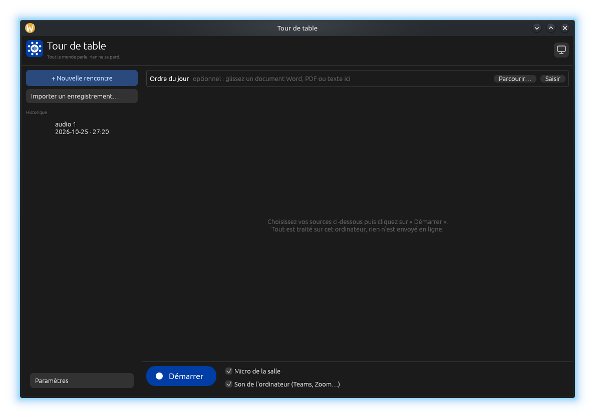

<p align="center"></p>

# Tour de table

> *Tout le monde parle, rien ne se perd.*

**Transcription de rencontres en français québécois, 100 % locale.**

Tour de table capte en même temps le **micro de la salle** et le **son des participants à distance**
(Teams, Zoom, Meet, Webex… tout ce qui sort de l'ordinateur), puis transcrit en français québécois
avec Whisper, directement sur votre machine. Aucun son ni texte ne quitte l'ordinateur.



Inspiré de [Meetily](https://github.com/Zackriya-Solutions/meetily), réécrit entièrement en Rust :

| | Meetily | Tour de table |
|---|---|---|
| Pile | Tauri + Next.js + serveur Python FastAPI | **Un seul exécutable Rust** |
| Interface | WebView (navigateur embarqué) | egui natif (rendu GPU) |
| Taille | Plusieurs centaines de Mo | **~12 Mo**, whisper.cpp inclus |
| RAM au repos | WebView + Python | **~90 Mo** |
| Langue | Générique | **Français québécois** (invite, typographie OQLF, lexique) |

## Pourquoi Rust?

* whisper.cpp est en C/C++ : Rust s'y lie sans surcoût (pas de cgo, pas de ramasse-miettes
  qui interrompt le fil audio en temps réel).
* Le fil audio et la transcription tournent sans pauses imprévisibles, et l'exécutable est petit.
* L'écosystème couvre déjà tout le nécessaire : `cpal` pour l'audio (WASAPI loopback sous Windows,
  « process tap » sous macOS), `whisper-rs` et `egui`.

## Mémoire : 16 Go minimum

Tour de table n'offre **aucun choix de modèle** : il utilise toujours **Whisper Large v3 Turbo q5**
(574 Mo à télécharger, ~1,2 Go de RAM en transcription, mesuré : 0,9 à 1,15 Go), le meilleur
rapport précision/vitesse sur l'accent québécois. Rien à régler pour déployer l'application dans
une organisation. **16 Go de mémoire vive sont nécessaires** pour le compte rendu : sous ce seuil,
Tour de table l'indique au démarrage.

* Modèle **quantifié en 5 bits** : environ 3× moins de mémoire, avec une perte de précision minime.
* Il reste en mémoire entre les rencontres (démarrage instantané).
* Le compte rendu se fait **après** la rencontre. Le modèle de langue n'est donc jamais en
  concurrence avec Whisper pour la RAM.
* Le contexte audio de l'encodeur est ajusté à la durée de chaque énoncé (au moins 15 s), au lieu
  des 30 s fixes de Whisper.
* **Regroupement adaptatif** : si la transcription prend du retard, les énoncés en attente sont
  fusionnés en une seule passe d'encodeur (jusqu'à 28 s), et Tour de table rattrape tout seul son retard.
* Réglages automatiques : fils de calcul (tous les cœurs moins deux, au plus 8), décodage simple
  (sans faisceau ni relances), accélération GPU si l'exécutable est compilé avec un moteur GPU, sensibilité de
  la détection de voix fixe.

## Spécialisation québécoise

* **Invite québécoise** : Whisper imite le texte qui précède. Tour de table lui fournit un contexte rédigé
  en québécois (« on commence-tu? », « tsé », « pantoute », « courriel », « dîner »…), suivi de la
  fin de la transcription en cours pour garder les noms cohérents d'un énoncé à l'autre.
* **Typographie OQLF** : « 14h30 » devient « 14 h 30 », « $10 » devient « 10 $ », pas d'espace
  avant ? ! ;, et une espace avant le deux-points.
* **Lexique** (Paramètres) : noms propres, organismes et acronymes, un par ligne, pour guider la
  reconnaissance. On peut aussi y mettre des corrections, p. ex. `hydro québec => Hydro-Québec`.
* **Filtre d'hallucinations** : Whisper invente parfois « Sous-titrage Société Radio-Canada » ou
  « Merci d'avoir regardé » sur du silence. Ces phrases sont retirées.

## Nettoyage de la transcription

Dès l'arrêt de l'enregistrement (pour un import : dès la validation du découpage par point), la
transcription est nettoyée en quelques secondes, point par point (« Nettoyage — point 3 sur 8 »). Jamais pendant un
enregistrement ou une transcription : une rencontre qui démarre interrompt le nettoyage, qui
reprend ensuite là où il en était (même après une fermeture de l'application).

* **La transcription brute n'est jamais modifiée.** La fiche de la rencontre propose les deux
  versions (« Brute / Nettoyée ») et un bouton « Relancer le nettoyage ».
* **Par règles, sans modèle de langue** : phrases coupées entre deux énoncés recollées, boucles
  de Whisper (même phrase répétée trois fois ou plus) réduites, hésitations retirées (« euh »,
  « hum », « bon ben » en début de phrase, « le le »), expressions de remplissage isolées entre
  virgules (« , genre, », « en fait, ») et simples interjections (« Ok. »), sauf quand elles
  répondent à une question ou à une proposition (un « Oui. » après « Je propose… » est un vote).
  Puis lexique et typographie. Les québécismes porteurs de sens (« tsé », « pantoute »,
  « correct ») sont gardés, comme un prénom (« avec Ben hier »). Les listes sont dans
  `data/nettoyage.txt`.
* Le modèle de langue sert seulement au compte rendu : une correction de chaque phrase par le
  modèle prenait plus que la durée de la rencontre sur un ordinateur sans carte graphique.
* Le compte rendu part de la version nettoyée. Exports : `transcription-nettoyee.md`, et un
  `transcription.md` dans le dossier de chaque point.

## Ordre du jour et compte rendu

Déposez l'ordre du jour **avant** la rencontre (sur l'écran de départ) ou **après** (dans la fiche
de la rencontre). Vous pouvez glisser le fichier dans la fenêtre, utiliser « Parcourir… », ou le
saisir à la main.

* **Formats** : Word (`.docx`), PDF texte, `.txt`, `.md`. La numérotation automatique des listes
  Word est reconstituée (1., 2., 2.1…). Un PDF numérisé en image n'a pas de texte lisible.
* **Points** : l'ordre du jour devient une liste de points (« 1. », « 1) », « Point 1 : », « I. »,
  « a) », puces, sous-points). « Modifier les points » permet d'en ajouter, d'en renommer, d'en
  supprimer ou de les réordonner, avant ou pendant la rencontre.
* **Découpage par point** : « Débuter le point » (qui démarre l'enregistrement au besoin) marque
  le point en cours ; on peut revenir sur un point déjà traité ou passer « Hors point ».
  Raccourcis : Ctrl + flèche droite ou gauche (point suivant ou précédent), Ctrl + H (hors point),
  Cmd sur macOS. La transcription et les exports portent un intertitre par point.
* **Avant la rencontre**, les sujets et les noms de l'ordre du jour sont ajoutés à l'invite de
  Whisper, ce qui améliore la reconnaissance des noms propres et du jargon.
* **« Rédiger le compte rendu »** suit la forme des comptes rendus d'organisme : en-tête (titre,
  date et heure, reprises de l'ordre du jour s'il les annonce), présences, puis chaque point de
  l'ordre du jour avec la même numérotation, et la levée de la séance. Chaque point est rédigé au
  présent et à la troisième personne : une phrase d'introduction (« Mme Bérubé présente… »), les
  éléments principaux en puces, puis ce qui est convenu (« Il est convenu que… »). Le tour de
  table donne quelques puces par personne, le varia un sous-titre par sujet, la prochaine
  rencontre quelques puces. Un point non abordé est indiqué comme tel, et le modèle a pour
  consigne de ne rien inventer.
* **Présences** : Tour de table ne reconnaît pas les voix ; la liste reprend les personnes qui
  prennent la parole dans les points rédigés (le tour de table surtout) et porte la mention
  « à vérifier ». Les « Mme » et « M. » sont aussi à relire.
* Le texte est rédigé en **français québécois standard** (terminologie et typographie de l'OQLF),
  puis la typographie est vérifiée par Tour de table (« 14 h 30 », « 2 500 $ »).
* **Garde-fou sur les chiffres** : tout montant ou nombre du compte rendu absent de la
  transcription et de l'ordre du jour est signalé dans un encadré « À vérifier ». Exemple réel
  avec Qwen2.5 7B : « budget dépassé de 200 $ », alors que 2 300 $ avaient été dépensés sur
  2 500 $. Le compte rendu reste un **brouillon à relire** avant diffusion.
* Sans ordre du jour, Tour de table produit un résumé structuré.
* **Compte rendu par point** : quand la rencontre est découpée par point, chaque point est rédigé
  à part, avec seulement sa transcription (« Compte rendu — point 3 sur 8 »), puis un dernier
  appel, à partir des points rédigés, ajoute les présences, les sujets hors ordre du jour et la
  levée de la séance. Chaque résumé est enregistré dans `resume.md` du dossier du
  point : un compte rendu interrompu reprend sans tout recommencer. Un point trop long (plus
  d'environ 24 000 caractères) est d'abord condensé par tranches.
* **Rencontres sans découpage par point** (anciennes, ou sans ordre du jour) : la transcription
  est rédigée d'un coup, condensée d'abord par tranches au-delà d'environ 45 min.
* Exporté dans `compte-rendu.docx` (Word : Calibri, titres en gras, puces, prêt à relire et à
  diffuser) et `compte-rendu.md`, et inclus dans `transcription.md`.

**Modèle de langue intégré : rien à installer.** Le programme auxiliaire `tourdetable-redaction`,
livré avec l'application, fait tourner llama.cpp sur l'ordinateur, avec un seul chargement du
modèle pour tout le compte rendu. Le modèle, le même sur tous les postes, est **Qwen3.5 9B**
(licence Apache 2.0, 5,7 Go à télécharger, ~6,6 Go de mémoire pendant la rédaction). Qwen3.5 4B,
deux fois plus rapide, inventait trop de sujets dans les comptes rendus. Il réfléchit
par défaut avant de répondre : Tour de table désactive cette réflexion, trop lente sur un
ordinateur sans carte graphique.

Chaque téléchargement reprend là où il s'était arrêté, et sa taille et son SHA-256 sont vérifiés ;
un fichier endommagé est supprimé et téléchargé une seconde fois. À chaque démarrage, la taille
des modèles est contrôlée : s'il en manque un (ou si une nouvelle version a changé de modèle),
l'écran d'installation revient pour ce qui manque seulement.
La transcription doit être terminée avant la rédaction : les deux modèles ne calculent jamais en
même temps.

## Sources audio

| Système | Micro de la salle | Participants à distance |
|---|---|---|
| **Windows 10/11** | WASAPI | Loopback WASAPI sur la sortie (aucun pilote à installer) |
| **macOS 14.6+** | CoreAudio | « Process tap » CoreAudio (autorisation demandée au 1er usage) |
| **Linux** | ALSA / PulseAudio | Source `.monitor` de PulseAudio ou PipeWire (`parec`) |

**Deux modes**, choisis dans les Paramètres par une seule question : « Les participants à distance
sortent-ils dans les haut-parleurs de la salle? »
* **Non : sources séparées** (défaut) : chaque segment est étiqueté **Salle** ou **À distance**.
  Idéal avec un casque, ou un haut-parleur de conférence qui annule l'écho.
* **Oui : sources mixées**. Le micro capte aussi les participants à distance : les deux sources
  sont réunies, sinon ils seraient transcrits deux fois.

La capture loopback de Windows ne livre rien quand aucun son ne joue. Tour de table réaligne donc chaque
source sur l'horloge pour garder des horodatages justes.

## Utilisation

1. Lancez Tour de table. Au premier démarrage, il installe tout seul ses deux modèles, sans rien
   demander : reconnaissance de la parole (574 Mo), puis rédaction des comptes rendus (5,7 Go).
   L'écran « Installation… » montre l'avancement et le temps restant. C'est la seule connexion
   Internet, et elle n'a lieu qu'une fois (Hugging Face). Vous pouvez fermer l'application en
   cours de route : l'installation reprend là où elle s'était arrêtée au démarrage suivant.
2. Au besoin, choisissez le micro et la sortie audio dans **Paramètres** (« Par défaut » convient
   le plus souvent), puis cliquez sur **Démarrer**.
3. La transcription s'affiche au fil de la rencontre et elle est sauvegardée après chaque phrase.
   Vous ne perdez donc rien en cas de panne.
4. À l'arrêt : **Rédiger le compte rendu** (modèle de langue local), **Exporter** (Markdown,
   texte, sous-titres SRT) ou **Copier**.

**Importer un enregistrement existant** : bouton « Importer un enregistrement… » ou glisser le
fichier dans la fenêtre. Formats : MP4 (enregistrements Teams), M4A (Zoom, téléphones), MP3, WAV,
FLAC, OGG. Le fichier devient une rencontre comme les autres : ordre du jour, transcription et
compte rendu. Décodage entièrement intégré (Symphonia), sans logiciel à installer, et en flux :
même un enregistrement de plusieurs heures n'est jamais chargé entier en mémoire. Une copie
intacte du fichier est gardée dans `source/` ; l'audio est rangé en blocs de 2 minutes,
transcrits l'un après l'autre (la progression s'affiche par bloc).

À la fin de la transcription, avec un ordre du jour, l'application propose le début de chaque
point d'après les annonces reconnues (« on passe au point 3… »). Un écran de vérification montre
l'heure proposée et la phrase qui l'a déclenchée ; on peut écouter 10 s autour de chaque
frontière, la déplacer, en ajouter ou en retirer, puis valider. Sans ordre du jour, tout reste
hors point : le bouton « Découper par points » de la fiche ouvre plus tard le même écran.

**Compte rendu automatique** : si un ordre du jour est joint (déposé avant l'import ou avant de
démarrer la rencontre), le compte rendu est rédigé dès la fin du nettoyage de la transcription
(pour un import, après la validation du découpage par point). On peut donc
déposer l'ordre du jour, importer l'enregistrement et revenir plus tard : tout est prêt.

**En arrière-plan** : la transcription d'un import et la rédaction du compte rendu se font
sans bloquer l'application, qui reste ouverte. Quand il faut vérifier le découpage par point,
puis quand le compte rendu est prêt, un avis s'affiche et l'icône est signalée dans la barre des
tâches (le Dock sous macOS) si vous travaillez dans une autre fenêtre. Le bouton
**Visualiser** de la fiche ouvre le compte rendu dans Word (`compte-rendu.docx`).

**Paramètres** : seulement le micro et la sortie audio, la question sur les haut-parleurs de la
salle et le lexique. Tout le reste (modèles, performance, détection de voix, conservation de
l'audio, compte rendu automatique) est décidé par l'application.

Ligne de commande, pour transcrire un enregistrement existant (il devient une rencontre du
dossier Musique, découpée par point d'après les annonces détectées, acceptées sans vérification).
Elle ne télécharge rien : lancez l'application une première fois, ou copiez les modèles (voir
« Déploiement en organisation »).

```
tourdetable --transcrire enregistrement.m4a                       # MP4, M4A, MP3, WAV, FLAC, OGG
tourdetable --compte-rendu ordre-du-jour.docx enregistrement.mp4   # ou transcription.txt
```

Emplacement des données. Les rencontres sont dans le dossier Musique, une par dossier nommé
d'après sa date et son titre (`2026-10-30-rencontre-ca-mensuel`, ou `2026-10-30-rencontre`
sans titre) ; renommer une rencontre ne renomme pas son dossier. Pendant la rencontre, l'audio
est écrit en blocs de 2 minutes ; à la fin, ils sont remplacés par un seul fichier,
`AAAAMMJJ-Rencontre-Tour de table.wav` (mode « Sources séparées » : un fichier `-salle` et un
fichier `-distance`). Les modèles, la configuration,
le journal et la corbeille restent dans le dossier de l'application. Les rencontres des versions
précédentes (et celles de « Noter », l'ancien nom) y sont déplacées automatiquement au lancement.

| Système | Rencontres | Modèles, paramètres, journal, corbeille |
|---|---|---|
| Windows | `Musique\Tour de table\` | `%APPDATA%\TourDeTable\TourDeTable\data\` |
| macOS | `~/Music/Tour de table/` | `~/Library/Application Support/ca.TourDeTable.TourDeTable/` |
| Linux | `$XDG_MUSIC_DIR/Tour de table/` (souvent `~/Musique`) | `~/.local/share/tourdetable/` |

## Déploiement en organisation

L'application est distribuée **sans aucun modèle** et n'a **aucun paramètre** de déploiement.

**Accès réseau.** Au premier démarrage, les modèles sont téléchargés depuis Hugging Face. À
autoriser dans le pare-feu ou le filtre Web : `huggingface.co`, qui redirige vers ses serveurs de
téléchargement en `*.hf.co` (constaté le 25 octobre 2026 : `us.aws.cdn.hf.co` depuis l'Amérique
du Nord ; le nom varie selon la région, d'où le joker). Un proxy est suivi s'il est déclaré dans
les variables d'environnement `HTTPS_PROXY`, `HTTP_PROXY` ou `ALL_PROXY` (exceptions :
`NO_PROXY`) ; le proxy configuré dans les réglages de Windows ou de macOS n'est pas lu. Les
certificats sont vérifiés par le magasin du système : un proxy qui inspecte le trafic chiffré
fonctionne si son autorité de certification est installée sur le poste.

**Postes sans accès Internet.** Copiez d'avance les deux fichiers ci-dessous dans le dossier des
modèles. Au démarrage, Tour de table calcule leur empreinte (quelques secondes, sans écran
d'installation) et les utilise directement ; un fichier dont l'empreinte ne correspond pas est
supprimé, et l'écran d'installation tente de le télécharger.

| Fichier | Octets | SHA-256 | Source |
|---|---|---|---|
| `ggml-large-v3-turbo-q5_0.bin` | 574 041 195 | `394221709cd5ad1f40c46e6031ca61bce88931e6e088c188294c6d5a55ffa7e2` | https://huggingface.co/ggerganov/whisper.cpp/resolve/main/ggml-large-v3-turbo-q5_0.bin |
| `Qwen3.5-9B-Q4_K_M.gguf` | 5 680 522 464 | `03b74727a860a56338e042c4420bb3f04b2fec5734175f4cb9fa853daf52b7e8` | https://huggingface.co/unsloth/Qwen3.5-9B-GGUF/resolve/main/Qwen3.5-9B-Q4_K_M.gguf |

| Système | Dossier des modèles (pour chaque utilisateur) |
|---|---|
| Windows | `%APPDATA%\TourDeTable\TourDeTable\data\modeles\` |
| macOS | `~/Library/Application Support/ca.TourDeTable.TourDeTable/modeles/` |
| Linux | `~/.local/share/tourdetable/modeles/` (ou `$XDG_DATA_HOME/tourdetable/modeles/`) |

Vérification de l'empreinte avant la copie : `Get-FileHash fichier` (PowerShell), `shasum -a 256
fichier` (macOS) ou `sha256sum fichier` (Linux). La version du Microsoft Store tourne dans un
paquet dont Windows peut rediriger le dossier `%APPDATA%` ; pour un déploiement hors ligne,
préférez la version `.zip`, ou vérifiez l'emplacement réel dans la première ligne de
`journal.txt`.

## Dépannage

* **Journal** : chaque lancement écrit `journal.txt` dans le dossier de données (voir plus haut),
  et le lancement précédent est conservé dans `journal-precedent.txt`. Joignez-le à toute
  demande d'aide.
* **L'application ne s'ouvre pas** (machine virtuelle, bureau à distance, pilote graphique
  absent) : Tour de table essaie d'abord Direct3D 12 sous Windows, y compris son rendu logiciel
  WARP, qui fonctionne sans carte graphique, puis OpenGL. Si les deux échouent, une boîte de
  dialogue affiche la raison. Pour imposer un moteur, définissez la variable d'environnement
  `TOURDETABLE_AFFICHAGE` à `wgpu` ou à `glow`.
* **Linux sous Wayland** : la fenêtre s'ouvre par X11 (XWayland) quand il est disponible, car
  le glisser-déposer de fichiers ne fonctionne pas autrement. Si l'affichage est flou ou mal
  dimensionné, définissez `TOURDETABLE_WAYLAND=1` pour garder Wayland (sans glisser-déposer :
  utilisez alors « Importer un enregistrement… »).

## Compilation

Prérequis : Rust (stable), CMake, Clang/LLVM. Sous Linux, ajoutez `libasound2-dev`.

```
cargo build --release                    # CPU (Windows, Linux)
cargo build --release --features metal   # macOS Apple Silicon (GPU)
cargo build --release --features vulkan  # GPU AMD/Intel/NVIDIA (SDK Vulkan requis)
cargo build --release --features cuda    # GPU NVIDIA (CUDA requis)
cargo test
```

Pour un exécutable à distribuer, ajoutez `GGML_NATIVE=OFF` (sinon il est optimisé pour le seul
processeur de la machine qui compile). Le flux GitHub Actions `.github/workflows/build.yml`
produit Windows (`.zip`), macOS (`.app`) et Linux (`.tar.gz`) à chaque étiquette `v*`.

Pour régénérer les icônes et les tuiles du Store à partir de `assets/logo.svg` : `cargo run --example gen_icons`.

### Microsoft Store

La compilation Windows produit aussi `tourdetable-windows-x64.msix`, le paquet pour le
Microsoft Store (manifeste : `packaging/windows/AppxManifest.xml`, identité du Partner Center).
Il n'est pas signé : le Store le signe à la publication. Les textes de la fiche du Store sont dans
`packaging/windows/fiche-store.md`, et la politique de confidentialité dans `CONFIDENTIALITE.md`. Celle-ci est publiée à
https://danlizhot.github.io/tour-de-table-confidentialite/ (dépôt public séparé). Après une
modification, régénérez la page avec
`python3 -I packaging/politique_html.py CONFIDENTIALITE.md <dépôt-public>/index.html`, puis poussez.

## Architecture

```
src/
  main.rs        point d'entrée (interface ou --transcrire)
  ui/mod.rs      interface egui : état, boucle, barre du haut, historique
  ui/live.rs     rencontre en cours, import, contrôles
  ui/past.rs     fiche d'une rencontre, compte rendu
  ui/nettoyage.rs file du nettoyage, « Brute / Nettoyée »
  ui/agenda.rs   ordre du jour
  ui/settings.rs Paramètres
  ui/installation.rs installation des modèles au premier démarrage
  ui/widgets.rs  composants, couleurs, logo vectoriel
  audio/mod.rs   capture micro + loopback par plateforme
  audio/dsp.rs   mono, rééchantillonnage 16 kHz (FIR), détection de voix, découpage
  recorder.rs    session : alignement horloge, mixage, changement de point
  audio/blocs.rs audio en blocs de 2 min par point, puis fichier unique : index, reconstitution, réparation
  stt.rs         fil Whisper (modèle gardé en mémoire)
  quebec.rs      invite, typographie, lexique, filtre d'hallucinations
  nettoyage.rs   nettoyage de la transcription, par règles (data/nettoyage.txt)
  storage.rs     rencontres (JSON) et exports MD/TXT/SRT
  models.rs      modèles (Whisper, rédaction), téléchargement et vérification
  agenda.rs      lecture de l'ordre du jour (Word, PDF, texte)
  summary.rs     compte rendu par le modèle intégré (découpage des longues rencontres)
  docx.rs        export du compte rendu en Word
  audio/import.rs  import d'enregistrements (MP4, M4A, MP3, WAV, FLAC, OGG), décodage en flux
  audio/frontieres.rs  rangement par point de l'audio d'un import (ou « Découper par points »)
  audio/lecture.rs écoute d'un extrait autour d'une frontière
  ui/verification.rs  vérification des frontières proposées
redaction/       programme auxiliaire de rédaction (llama.cpp), séparé à cause de ggml
  cli.rs         commandes --transcrire et --compte-rendu
```

Fils d'exécution : `audio` (capture → 16 kHz → VAD → énoncés) → `whisper` (transcription) →
interface. Aucun travail lourd ne se fait dans le fil de l'interface.

## Le logo

Une **table ronde** vue de haut, huit **participants** autour et, au centre, une **onde sonore** :
la conversation qui fait le tour de la table. Le tout sur le **bleu du drapeau du Québec**.
Source vectorielle : `assets/logo.svg`.

## Nous joindre

[tourdetable.app@outlook.com](mailto:tourdetable.app@outlook.com)

## Licence

MIT. Inspiré de Meetily (MIT, Zackriya Solutions).
